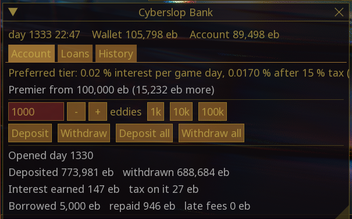

# Bank

A small bank in one Cyber Engine Tweaks window: an account with interest, deposits and withdrawals anywhere, personal loans and a credit score. Single-player only.
Version 1.0.1 | Built for game version 2.5 | Status: not run in game yet



## What and why

It replaces two larger bank mods with one window that does no work while it is closed.

- **Account.** Deposit and withdraw from anywhere. Interest is paid daily by balance tier: Standard from 0, Preferred from 25,000, Premier from 100,000, Private Client from 250,000 and Obsidian Client from 1,000,000 eddies, at 1 to 5 basis points per game day, with 15 % tax on interest. Interest is paid only on the part of the balance above what you owe the bank.
- **Loans.** Personal loans with 6, 12, 24, 36 or 60 payments, one payment every 30 game days, taken from the account. The interest rate (24 % down to 4.5 % a year) and the limit (5,000 up to 100 million) depend on the credit score. A missed payment costs a late fee (5 %, at least 100) and score points; three missed payments in a row put the loan in default, and then every deposit pays the overdue amount first.
- **Credit score.** 300 to 850, starting at 600.
- **History.** A transaction list with a balance chart.

The tier, tax, rate, limit and score numbers are taken from Marmur Bank Overhaul.

How it stays light: no Observe or Override hooks, no onUpdate handler, no timers, no files. Interest and loan payments are settled from the game clock when the window opens or the summary hotkey is pressed; because the account only changes through this mod, settling late gives the same result as settling every day. The bank state is stored in the save as quest facts (`csbank_*`), so it loads and reloads with the save.

```text
package/
  bin/x64/plugins/cyber_engine_tweaks/mods/CyberslopBank/init.lua
```

## Requirements

- Cyberpunk 2077 2.5
- [Cyber Engine Tweaks](https://www.nexusmods.com/cyberpunk2077/mods/107)

Optional: [Cashflow](../cashflow/README.md) from this collection receives a source tag for each money change the bank makes.

Requirements are not bundled. Install them first.

## Install

1. Install the requirements above.
2. Copy the contents of `package/` into the game folder, so that `bin\x64\plugins\cyber_engine_tweaks\mods\CyberslopBank\init.lua` exists.
3. Start the game, load a save and open the CET overlay: the "Cyberslop Bank" window shows.

## Uninstall / roll back

1. Withdraw your balance first: money in the account stays in the save as quest facts and is not visible without the mod.
2. Close the game.
3. Delete `bin\x64\plugins\cyber_engine_tweaks\mods\CyberslopBank\`.
4. Saves load fine without the mod.

## Configuration

Two hotkeys in CET > Bindings (unbound by default): "Bank summary (HUD line)" and "Show / hide the bank window". Amounts, loan size and term are chosen in the window.

## Changelog

| Version | Date | Game version | Change |
|---|---|---|---|
| 1.0.1 | 2026-11-23 | 2.5 | A loan paid off on the day it was taken no longer raises the credit score; interest only on the balance above what you owe |
| 1.0.0 | 2026-11-22 | 2.5 | First version |

Back to the [mod list](../../README.md).
